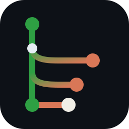

<div align="center">



# Project-Artinarey

### Give every AI coding agent its own worktree, mailbox and task scope.

*Many agents. Many lanes. One project. You still do the merging.*


</div>

> **Design settled. Foundation, MCP shim and worktree manager implemented and tested; two-agent mail exchange verified in OpenCode and the worktree lifecycle smoke-tested.** Nothing is installable yet. The full design, the evidence behind every decision, and the progress tracker live in [`plan.md`](plan.md).

---

## Contents

- [The problem](#the-problem)
- [Before and after](#before-and-after)
- [How it works](#how-it-works)
- [A day with Artinarey](#a-day-with-artinarey)
- [The personas](#the-personas)
- [What's included](#whats-included)
- [Safety and control](#safety-and-control)
- [Quick start (planned)](#quick-start-planned)
- [Supported tools](#supported-tools)
- [Progress](#progress)
- [FAQ](#faq)
- [License](#license)

---

## The problem

- You asked an agent to build a feature, and now you are **watching it type**.
- You opened a second agent on the same repo. Now two agents edit the same file and one of them silently loses.
- You have one tool in one terminal and another in a second, and **neither knows the other exists**.
- You are the mail carrier: copy from agent A, paste into agent B, repeat.
- You come back from lunch with no idea who was doing what.

Artinarey is the office that fixes that. Each agent gets a private desk, an internal mailbox, and a floor manager who stops two of them from editing the same file. You remain the boss and you merge every branch yourself.

---

## Before and after

| | Today | With Artinarey |
|---|---|---|
| **Speed** | One agent at a time | Several agents, each in its own lane |
| **Collisions** | Two agents, one folder, lost work | One git worktree and one branch per agent, plus path leases |
| **Talking** | You copy and paste between tools | Agents mail each other through one local MCP server |
| **Planning** | You juggle it in your head | One senior dev splits the work; code checks that scopes don't overlap |
| **Overview** | A dozen terminal tabs | One calm window with every project, agent, branch and thread |
| **Storage** | Chat logs scattered everywhere | One folder per project, on the drive **you** choose, with a **Move** button |
| **Privacy** | Depends on the tool | Mail stays on your machine; only a separate API adapter calls a model API |

---

## How it works

```text
              you
               │  talk to the senior dev, or to any persona
               ▼
       ┌──────────────┐    launch / watch     ┌──────────────────────────┐
       │  Artinarey   │ ────────────────────▶ │  OpenCode agents         │
       │   daemon     │ ◀──────────────────── │  one per worktree        │
       └──────┬───────┘     MCP: mail, tasks  └──────────────────────────┘
              │
              ├──▶ mail files · task journal · leases · audit log
              │    (one folder per project, on the drive you pick)
              └──▶ API adapter ──▶ model API (configurable base URL)
                   the only outbound caller
```

1. **Open a project.** Artinarey reads `git worktree list`, so worktrees made by other tools show up too.
2. **Start a persona.** Pick a worktree. If that persona last worked somewhere else, you get a warning first.
3. **The agent connects over MCP.** The folder it runs in tells Artinarey who it is.
4. **Work gets assigned.** The senior dev splits a task, or you assign it directly. Overlapping scopes are rejected by code, and an idle persona on the same branch gets priority over a new session.
5. **Risky calls ask you.** Anything that reaches outside the agent's worktree blocks until you approve it.
6. **Branches are ready. You merge.** Nothing merges itself.

---

## A day with Artinarey *(planned)*

> **09:00**  You tell the senior dev: *"Add login, rate limiting, and docs."*
> **09:02**  It splits the job into three tasks with three separate sets of paths. The daemon checks that none overlap.
> **09:03**  Developers start in their own worktrees. The senior dev wants one more than your cap allows, so a warning appears and the extra session waits for your approval.
> **09:40**  A tester mails a developer: *"Login returns 500 on empty password."* You didn't copy-paste anything.
> **10:05**  A developer runs `git push`. Its session stops and waits; your desktop notifies you immediately. You approve in the window.
> **10:15**  One developer touches a file outside its lease. The pre-merge panel lights up red.
> **10:30**  Three branches are ready. You read the diffs, merge them in the order you like, and go get lunch.

---

## The personas

A persona is a durable identity with a mailbox, a journal, and a home worktree. Sessions come and go; personas remember.

| Persona | What they do | What they can't do |
|---|---|---|
| **Senior dev** | Splits work, assigns tasks, requests new sessions, chains steps with approval gates. Exactly one per project. | Launch anything itself; the daemon validates every request. It never creates subagents and cannot delete personas. |
| **Developer** | Builds the task inside its own worktree. | Edit outside its lease. |
| **Researcher** | Finds libraries and options, mails a recommendation. | Write code. |
| **Tester** | Runs the app, hunts bugs, mails findings. | Fix code. |

New sessions are completely independent and keep running even when the senior dev is idle. If an idle persona can take the work on the same branch, it gets priority. Direct assignments from you get the same lease checks as senior-dev assignments.

---

## What's included

<table>
<tr>
<td width="50%" valign="top">

### Worktree-native
Every working agent gets its own worktree and branch under `.worktrees/`. Create new worktrees from the window, adopt existing ones, and see which persona lives where.

### Home worktrees
Start a persona somewhere other than where it last worked and you get a warning in both the CLI and the window. Edit a persona's home worktree any time, within the same project.

### Path leases
Each task owns its paths. Overlaps are rejected up front. A git hook and a pre-merge check flag edits outside the lease. Shared hot files are handed to one task at a time.

</td>
<td width="50%" valign="top">

### Controlled mail
Addressed messages only. No broadcast. Everything is logged. Mail is immutable plain Markdown you can read with any editor.

### Storage you control
Choose where records live. When a drive fills up, use **Move**: pause, copy, verify checksums, switch, and delete the old copy only when you say so.

### One minimal window
Projects, personas, worktrees, mail, tasks, sessions, audit. Talk to one persona at a time.

</td>
</tr>
</table>

---

## Safety and control

- **Your boundary is the agent's assigned worktree** — not the whole project, and not another worktree of the same project. Network access, other worktrees, and global git operations such as `git push` and `git tag` need your approval. Local commands, including a Python script that only writes inside the worktree, proceed.
- **An obvious auto-approve toggle** lives in the worktree view. It is user-only, per worktree, and OFF by default. When ON, risky worktree-confined calls proceed automatically; out-of-worktree calls still ask.
- **Blocked agents wait indefinitely.** You get an OS desktop notification immediately, again at 5 minutes, again at 15 minutes, then silence. No timeout auto-fail. A blocked session still counts toward the cap. Approve in the GUI or the CLI, depending on how the agent was launched.
- **Spawn cap:** 3 running sessions per project, soft. Going over it shows a warning phrased around token consumption. Artinarey does not measure tokens or cost; a cost estimate would be misleading for people on free models. A senior-dev request over the cap waits for your approval.
- **Overlap checks are plain code**, not an LLM. An append-only audit log records mail, launches, approvals and every toggle flip.
- **You merge by hand.** A pre-merge check compares changed files with the task's lease and shows red flags.

**Known risk, accepted:** out-of-worktree detection uses command and path heuristics. It can be bypassed — for example, `curl` launched inside the worktree reaches the network, and a Python script can open a file outside the worktree without naming an outside path in the command. This is **not an OS sandbox**. Docs describe out-of-worktree use as *detected and approval-gated*, never impossible. See [`plan.md`](plan.md), section 13.

---

## Quick start (planned)

<details>
<summary><b>30-second version</b></summary>

<br>

Artinarey is a small office for your AI agents. Each gets a private desk (a worktree), an internal mailbox (MCP), and a floor manager (the senior dev) who stops two people from editing the same file. You stay the boss and do all the merging.

</details>

<details>
<summary><b>Commands (planned interface)</b></summary>

<br>

```bash
# one-time, per repo
artinarey init                          # register the project, write the folder marker
artinarey storage set /mnt/big-drive    # choose where records live

# worktrees
artinarey worktree new auth-api         # .worktrees/auth-api on branch artinarey/auth-api
artinarey worktree list                 # includes worktrees made elsewhere; adopt with `worktree adopt`

# agents and approvals
artinarey connect opencode              # writes the MCP entry for you
artinarey run opencode --persona dev-auth   # warns if dev-auth's home is another worktree
artinarey status                        # who is where, doing what, unread mail
artinarey approvals                     # calls currently blocked on your decision
artinarey approve <id>                  # approve one call (user only)

# records
artinarey move my-project /mnt/other-drive  # pause, copy, verify, switch; you confirm the delete
artinarey verify artinarey/auth-api         # pre-merge check against the task's lease
```

</details>

<details>
<summary><b>The window (planned)</b></summary>

<br>

- **Projects:** where each project's records live, size, free space, online or offline.
- **Personas:** who is active, what each last did, home worktree (editable), Start / Resume / Release.
- **Worktrees:** create, adopt, see branches and what changed. The auto-approve switch sits here, per worktree.
- **Mail:** every thread, by project and persona.
- **Chat:** one persona at a time. Anything you tell a persona is copied to the senior dev.
- **Approvals:** blocked risky calls, spawn over the cap, scope requests, takeovers.
- **Pre-merge:** changed files versus the task's lease, red flags first.

</details>

---

## Supported tools

| Tool | Status | What Artinarey can do |
|---|---|---|
| **OpenCode** | First | Launch sessions in a chosen worktree, send messages from the window, watch status |
| **Model API adapter** | Next | A separate process that calls a model API through a configurable base URL; the daemon passes prompts and results over a local socket |
| **Claude Code** | Postponed | Project `.mcp.json` is verified, but a cloned repository can't approve its own servers |
| **Codex** | Postponed | `cwd` and static headers exist, but project config loads only in trusted projects |
| **Antigravity** | Postponed | Headless needs cached credentials and soft-denies approval-requiring tools with exit 0 |

Any tool you start by hand with `artinarey run` still gets mail and tasks, as long as it speaks MCP.

---

## Progress

`████░░░░░░░░░░░░░░` **4 of 9 milestones. Design settled, M3 implemented and tested; two-agent mail exchange verified in OpenCode and the worktree lifecycle smoke-tested.** The M0 spike passed on 2026-11-23, M1 added the store, mail, registry and daemon, M2 added the MCP shim, folder-based identity and eight tools, and M3 added worktree create/adopt/list/remove, home-worktree warnings and `run`; no adapter or window exists yet.

| | Milestone | Status |
|---|---|---|
| M0 | Spike: can the MCP shim see the agent's folder? | ✅ |
| M1 | Store, mail files, daemon | ✅ |
| M2 | MCP shim and identity by folder | ✅ |
| M3 | Worktree manager and home-worktree warnings | ✅ create/list/remove and `run` smoke-tested |
| M4 | Leases and pre-merge check | — |
| M5 | OpenCode adapter, spawning and approvals | — |
| M6 | Read-only window *(first usable slice)* | — |
| M7 | Chat, dialogs, approvals, **Move** | — |
| M8 | Model API adapter *(other vendors postponed)* | — |

All 14 assumptions were checked and all 3 open decisions were closed on 2026-11-23. M0 then confirmed the worktree-identity and shared-git-metadata assumptions against real tools; results are in [`plan.md`](plan.md), section 0. Section 17 holds the research evidence — the source of truth for task checklists and estimates.

---

## FAQ

<details>
<summary><b>Is it really local?</b></summary>

<br>

Mail and records never leave your machine, and the daemon makes no outside network calls except to localhost. The separate API adapter is the only component that calls a model API. One honest caveat: anything an agent *reads* is sent to that agent's model provider, just like any text it reads. Keep secrets out of mail.

</details>

<details>
<summary><b>Will it merge my code?</b></summary>

<br>

No. You merge everything by hand. Artinarey shows you which branches are ready and which files each one touched outside its lease.

</details>

<details>
<summary><b>Will parallel agents be faster on a free plan?</b></summary>

<br>

Free-tier models work only inside OpenCode; other harnesses get HTTP 403 even with a key, so they need a paid model or subscription. Beyond that, request limits are shared. Artinarey keeps its own routing free of LLM calls and shows best-effort request counts, but it does not measure tokens or create quota.

</details>

<details>
<summary><b>Can an agent escape its worktree?</b></summary>

<br>

It can ask. Calls that reach outside the assigned worktree are detected and block until you approve. Detection is heuristic and bypassable, so this is not a sandbox. See [`plan.md`](plan.md), section 13.

</details>

<details>
<summary><b>What if two agents need the same file?</b></summary>

<br>

Overlapping task scopes are rejected up front. Shared hot files (lockfiles, `package.json`, migrations) are handed to one task at a time.

</details>

<details>
<summary><b>What if my drive fills up or goes missing?</b></summary>

<br>

Use **Move** to relocate a project's records. If a drive disappears, agents are told to stop and wait, and Artinarey never creates an empty replacement store.

</details>

---

## License

Artinarey is licensed under the **GNU General Public License, version 3 (GPL-3.0)**. The full text is in [`LICENSE`](LICENSE).

`SPDX-License-Identifier: GPL-3.0-only`

This is a strong copyleft license: if you distribute a derivative work, you must make its source available under the same terms. Dependencies are pinned in the workspace manifests; GPL compatibility has not been audited — check before publishing.

---

<div align="center">


**Many agents. Many lanes. One project.**

</div>
